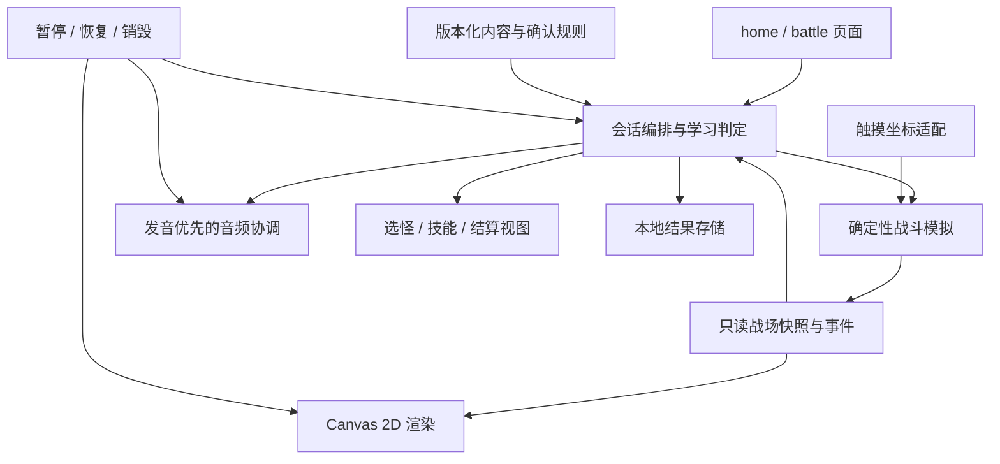

# 单词怪物：动作玩法最小 MVP 架构（V2）

规划日期：2026-10-30。本文是新版实施依据；规则已由用户确认，#19 数据契约与确定性计划已实现；尚未接入新版战斗页面。详细规则见 [已确认规则 A1—C8](docs/mvp-v2-rules-proposal.md)。

当前页面仍运行 V1 听音选图与攻击反馈；V2 基础模块独立位于 `miniprogram/fortress/`。V1 资源基线为 `58dacde`。历史架构、原规则和验收记录完整保留于 [V1 归档](docs/archive/architecture-v1.md)，调整前工单正文保留于 [工单快照](docs/archive/issues-before-v2.json)。V1 的通过测试不得算作 V2 动作游戏验收。

## 1. 产品目标与决策状态

面向小学 1—2 年级英语入门儿童，验证“听词辨认水果怪物，并亲自操控角色完成一小波射击”的兴趣和可用性。通关、击杀、技能等级不等于词汇掌握。

本轮按上文推荐的流程规划：先听单词，从右侧怪物头像中选出对应目标，选对后进入该词的战斗。此规划不是自由挑怪后才播放单词的模式。

| 状态 | 内容 |
| --- | --- |
| 用户明确方向 | 底部主角拿武器、可左右移动；上方怪物逐渐登场；可见子弹与命中；波次结束获得技能；退场留短暂残影并读出该词；主角位于下方堡垒基地，怪物抵达后攻击基地，基地有血条，归零失败 |
| 用户新增素材要求 | 水果怪物必须联网寻找并下载，可爱优先，少量怪诞元素；普通水果图标不能当成怪物最终交付 |
| 用户确认局内技能范围 | 双发、射速提升、子弹变宽；波间随机二选一，仅本局生效，细则已按 A1—C8 确认 |
| 用户明确后置 | 战斗掉金币、金币升级武器与装备，属于后续成长系统，不进入最小 MVP |
| 本次架构选型 | 原生小程序 + TypeScript + Canvas 2D 战场 + WXML 操作界面，无后端、无通用游戏引擎 |
| 已确认最小规模 | 5 波，每波 1 只对应单词怪物；右侧 2 个头像；拖动水平移动、自动开火；前 4 波随机二选一技能，最后一波直接结算 |
| 已确认攻防与技能 | 基地 5 血、怪物 8 血、子弹伤害 1；到达后每 2 秒攻击 1 点，波间不回血；同一步先结算命中再让存活怪物攻击；技能各最多 3 级，参数及教学/存储/音频故障规则见 A1—C8 |

继承且未与新方向冲突：5 个水果词 apple、banana、orange、grape、watermelon；中文操作说明、预制英文发音；可无限重播；首次错温和反馈并重播，第二次错后提示正确头像，保留至选对；错误重试不换位；不持久化局中快照，退出重开；保存最近 20 局终局记录（含失败）；不显示“掌握率”。继承项已随 A1—C8 核对，冲突以新确认规则为准。

## 2. 最小闭环与明确排除

1. 首页开始新局，先加载并校验当前内容包和 Canvas；首次开局展示五词图音教学，此后可跳过，教学不计学习成绩。
2. **听词选怪**：战场不推进，主角不射击。播放目标词，右侧出现无文字答案的水果怪头像；播放结束且头像加载完成才接受选择。
3. **选择反馈**：错误只重播/提示；正确提交一条学习记录并锁定选择，进入当前波。正确选择本身不杀怪、不拆盾、不发技能。
4. **怪物登场与战斗**：怪物从上方逐步出现；主角位于底部堡垒，沿用左右操控方向，逻辑战场 360×560，主角中心 y=510，x 范围 24—336。主角自动发射子弹；位置、发射节奏、碰撞、怪物耐久和基地血量都由模拟模块计算。怪物抵达基地后进入攻击状态，按确认节奏扣基地血量，不能仅因抵达就消失。
5. **退场与词音**：怪物耐久归零只产生一次击败事件。停止本波新子弹，怪物保留短暂半透明轮廓/残影，同时清晰播放该词，再消散；显示普通水果图片和英文以对应真实物品。残影不能继续被命中。
6. **波次完成**：当前波计划生成的怪物均已处理且退场流程完成，才进入技能选择或整局完成。基地血量归零则立即停止战斗并进入失败结束，不再发技能或进入下一波。先结算命中，再让存活且到期的怪物攻击，首次攻击需抵达后等待完整 2 秒。
7. **技能选择**：在非最后一波按已确认规则生成一次候选卡，孩子选择后仅影响随后战斗参数；暂停/恢复/重绘不重新抽取。
8. **结算与重玩**：分别展示通关或基地被摧毁，以及真实听词选择表现和战斗完成波次；只有满足已确认保存范围的结果才持久化；再次挑战创建新会话，清空局内技能和战场实体。

明确排除：金币掉落与计数、钱包、商城、装备库存、永久升级、付费抽奖、技能稀有度、账号/云同步、社交榜单、广告、实时 AI、录音评分、长剧情、多关卡地图。当前不做多怪同屏、Boss 专属阶段、复杂物理或伤害飘字；若后续扩大规模，先调整规则和工单。

## 3. 页面、布局与资源

仍保留 home/battle 两页，不新增独立报告页或商店。

- home：简短玩法说明、开始入口、可展开素材署名。首页角色图必须与新版主角风格协调。
- battle：上/中部 Canvas 战场，主角位于底部堡垒，显示基地血条；移动范围按 A6 映射；右侧独立头像选择栏，在听词阶段可用，在战斗阶段锁定/隐藏；下方拖动控制区与重播入口分开，避免手指遮住怪物。
- 技能选择和结算：WXML 覆盖面板，显示时停止模拟与攻击输入；界面保留微信原生返回，不恢复已移除的内部“返回首页”按钮。
- 普通水果图：现有 OpenMoji 资源用于教学/退场对照，不再兼任怪物。怪物、头像、普通水果通过 wordId 对应，视图不能从图片形状猜题。
- 可爱怪物：联网下载 apple/banana/orange/grape/watermelon 五种，优先统一画风、圆润轮廓、夸张表情，水果特征明显；不做血腥、写实伤口或突然惊吓。提供可复核的素材预览，完成可爱度与词物辨识视觉检查；许可与儿童辨识检查是独立验收。
- 下载候选先建立来源/作者/许可证/是否可改作/是否付费/文件路径/哈希/审校清单；不抓取来源不明的搜索缩略图。缺少合适授权时列出候选和缺口，不擅自生成替代、不自动购买。
- 第一版可用一张怪物透明 PNG 配合位移、缩放、受击变色和透明残影完成动作，不要求昂贵的逐帧素材包。主角/堡垒基地（含受击与摧毁状态）/武器/子弹素材同样登记来源与许可。

现有五段 MP3 已能在模拟器加载并自然结束，真人听审仍待完成。角色图、武器、音效尚未完成，不把 10 个水果图音文件等同于新版素材包。

## 4. 技术架构与责任边界

| 模块 | 接口方向与职责 | 禁止承担 |
| --- | --- | --- |
| content | Word/MonsterVisual/WavePlan/SkillDefinition，完整引用与参数校验 | 运行中随机抓图或生成发音 |
| session reducer | 接受带会话版本的选择/战斗/技能事件，输出状态与效果；决定开始下一波和完成 | 逐帧 setData、直接绘图或播放 |
| combat simulation | createCombat、step(dt, input)、applySkill；位置/弹体/碰撞/怪物耐久/基地血量与受击/击败或失败事件；注入随机源 | 微信 API、音频、学习正确率、永久成长 |
| Canvas renderer | 预载图片、DPR/逻辑尺寸映射、根据快照画角色/子弹/残影，管理唯一帧循环 | 自行判命中、扣血、发技能或完成关卡 |
| battle controller | 执行效果，将战斗、音频、视图与生命周期连接，管理资源所有权 | 绕过 reducer 结算或重抽技能 |
| audio coordinator | 题目/退场发音优先、音效互斥、轮次与实体 token、超时/失败重试 | 用音频结束宣告怪物被击败 |
| progress | 验证版本、按 sessionId 幂等保存最近 20 局通关/失败结果，读取损坏回退 | 钱包、装备存档、局中恢复 |

渲染选择：Canvas 2D 用于真正连续运动的实体；WXML/WXSS 用于静态操作界面。不要用每帧 setData 驱动子弹，也不引入 WebGL、复杂场景树或通用物理引擎。

帧循环使用 Canvas.requestAnimationFrame 驱动；模拟采用固定逻辑步长、累积时间与有限补帧，时钟/随机源可注入。恢复前台重置上一帧时间，不追赶后台经过的几十秒。高速子弹使用线段/扫掠碰撞或等价防穿透方法；同一颗普通子弹命中后消耗一次，本版不穿透。帧率目标和同屏实体上限在技术验证工单测量并记录，不假称真机已达标。

## 5. 状态与幂等规则

会话状态流（#10 接线实现）：

`loading → presenting → awaitingChoice → spawning → fighting → retiring → skillChoice → presenting … → completed`

另有 `choiceFeedback`、`paused`、`resourceError`、`audioError`；用户已确认 `fighting → failed`：基地血量归零即失败。怪物包含 entering/alive/attackingBase/defeated/retiring 状态，抵达基地后仍可被子弹击中。

- 题目发音失败：停留原选择任务，显式重试，不计答错、不生成怪物。
- 怪物图片/Canvas 初始化失败：不开始碰撞或自动判胜，显示可理解的重试/原生返回提示。
- 选择正确：只提交 Attempt 并生成一次 combatId；学习选择和战斗击败是两种不同事实。
- 子弹命中：模拟以 projectileId + monsterId 判重；怪物 alive → defeated 只能一次；退场渲染回调不再扣耐久或加奖励。
- 退场：击败事件先提交，再呈现残影/发音；音效降低或停止。退场发音失败不撤销击败，提供“重听”和“继续”，继续不伪记音频已完成；不能无限卡住或静默误记为已播放。
- 波次清空：依据计划生成数量、当前存活实体和已处理击败集合，不能用“屏幕暂时没怪”或动画计时器判断胜利。
- 技能选择：候选在进入面板时生成一次；offerId 单次消费、应用一次。旧卡片点击不能升级新波。
- 胜负：基地归零即进入 failed 终态；最后一波全部击败且基地存活，退场处理后进入 completed。同一逻辑步先结算子弹命中，再让存活怪物攻击，不能依赖渲染顺序偶然判定。两个终态均停止发射、伤害和新技能，终局事件一次性处理；最后一波不再弹技能。
- 暂停：冻结会话和模拟时间，取消帧调度、停止声音、释放触摸状态；恢复同一快照，不重生怪、不补射、不重抽技能。
- 退出：销毁 renderer/audio/timer/listener，释放会话；迟到事件按 sessionId/waveId/combatId/generation 拒绝。

需要把高频 combatTick 与低频会话 revision 分开：不能每帧更新学习事件版本导致音频全部失效；低频阶段切换更新 generation，暂停恢复也使旧异步效果失效。

## 6. 数据契约与学习口径

类型已定义于 `miniprogram/fortress/types.ts`，配置和计划校验位于同目录 `validation.ts`；这些契约不代表模拟/页面接线已完成：

| 契约 | 关键字段 |
| --- | --- |
| Word | id、text、meaningZh、fruitImagePath、audioPath；沿用原词条 ID |
| MonsterVisual | wordId、portraitPath、spritePath、碰撞边界/锚点、授权与审校引用 |
| WavePlan | waveId、targetWordId、optionWordIds、spawnPlan；选项/词序本局一次生成 |
| CombatState | combatId、tick、player、base(hp/maxHp)、monsters、projectiles、已处理击败/基地攻击 ID；战斗参数来自已确认配置 |
| SkillDefinition / Offer | skillId、效果类型与参数、等级/叠加约束；offerId、candidateIds、selectedId |
| AttemptV2 | sessionId、waveId、targetWordId、selectedWordId、correct、attemptIndex、hintUsed、replayCount、taskKind |
| WaveResult | waveId、wordId、选择完成事实、击败实体、结束原因；发音失败/重试仅为诊断事实 |
| SessionResultV2 | schemaVersion、contentVersion、mode、sessionId、outcome(victory/baseDestroyed)、completed、attempts、waves、skillChoices、endedAt |

replayCount 沿用原口径：主动/答错重播计入；首次题目播放、退场读词、音频故障重试和后台恢复播放不计入。自动射出的子弹、命中次数和退场发音不能制造额外学习 Attempt。

统计只读取听词选择：首次无提示答对、错后无提示完成、提示后完成；教学项单列。总任务数取实际配置与完成记录，不再写死 10。基地失败不能伪装通关；已答对但尚未击败的当前波，学习选择与战斗完成分开展示。按 B8 保存最近 20 局终局结果，包含失败局并区分 outcome；中途退出不保存。

V2 使用 mode=fortress、schemaVersion=2、contentVersion=2 和独立存储键 `word-monster:fortress:progress:v2`；不把 V1 的 15 题/护盾/能量结果强制转换为波次记录。可保留旧原始记录用于历史兼容，但不拿来恢复战斗或与新版统计混算。当前还未实现生产存储，不虚构已有用户存档迁移。

## 7. 局内技能与后置成长

用户已确认 MVP 局内技能范围：双发、射速提升、子弹变宽；波间随机提供两个选择，选一项后改变后续模拟参数。从未满级技能等概率抽取两个不同候选；每类最多选 3 次。双发对应每次 1→2→3→4 弹，射击间隔 500→400→300→200 毫秒，弹宽 8→12→16→20；各效果独立叠加。技能不得替孩子完成下一波听词选择，也不能凭动画自动击败怪物。

金币/装备属于后续独立工单：掉落/拾取、钱包、武器与装备升级、价格曲线、跨局保留、存档策略和公平性一起设计。本版不提前写 coinBalance、商店占位、付费接口或永久属性，以免未确认经济规则反向限制 MVP。

## 8. 旧代码复用与迁移

| 已有内容 | 新版处理 |
| --- | --- |
| #2/#3 工程、AppID、原生两页、TS 与测试工具 | 保留 |
| #5 词条、资源校验与随机选项工具 | 复用工具；废止固定三阶段生成器作为 V2 出题入口，新增 WavePlan |
| #6 引擎 | 保留事件隔离、Attempt 思路与历史测试；新会话 reducer 不继承 3/7 能量和护盾逻辑 |
| #7 音频 | 保留播放器与一次性回调隔离，新增退场/音效协调契约 |
| #8 首页/内存会话 | 改为创建 V2 会话和玩法说明；继续防连点与失败清理 |
| #9/#10 battle controller/WXML | 复用事件桥接、素材加载失败处理和生命周期经验；分拆为选择 UI + Canvas + 新编排 |
| 普通水果图与五段 MP3 | 保留授权资料；水果图用于教学对照，怪物图另下载；录音仍需听审 |
| V1 自动测试与记录 | 保留至替代路径有回归覆盖；不能以其通过声明 V2 已完成 |

实施顺序：已冻结规则和新契约 → 素材准备与模拟/渲染的独立可测模块 → 一波完整闭环 → 技能和全局流程 → 保存/生命周期/结算 → 真机与儿童试玩。迁移完成后删除无调用的旧入口，不长期维护两套可选玩法，不向用户展示内部版本切换。

## 9. 验证与交付标准

- 规则与来源：业务参数按已确认规则执行；五种可爱水果怪有许可记录、可复核预览、视觉审校和图音词匹配；发音听审完成。
- 纯逻辑：固定种子重放同一输入得到相同波次/技能候选和战斗结果；重复选择、命中、击败、退场回调、技能点击、完成事件均只结算一次。
- 真实战斗：移动能改变射线位置，子弹有飞行过程，碰撞决定命中；错选不能开战，选对不直接消灭怪物；怪物抵达后攻击基地，基地血量不为负，归零立即失败且不再推进。
- 暂停/恢复：在听词、登场、射击、退场、技能、保存阶段切后台；无后台补帧、瞬移、残留声音、重抽或重复保存。
- 页面与资源：右侧选择栏不显示答案文字、不遮挡操作；无内部返回首页按钮；所有素材本地可用，缺失时不自动判胜。
- 真机：低端目标机与主流机上验证触摸/DPR/音频/帧时间/实体上限/包体/内存趋势，记录机型与基础库；不能仅凭 Canvas API 存在宣称性能达标。
- 结果：学习三类合计等于实际完成的学习任务数，教学与战斗操作分开；保存失败有反馈且仍可重玩；基地失败可重开，重开清空怪物、技能与旧回调并恢复确认的初始基地血量。
- 产品：真实儿童能否理解听词选怪和移动、是否愿意再玩、是否害怕怪物、离开射击场景后能否辨词；不能用试玩时长单独推断学习效果。

技术、素材与试玩分别验收。金币成长不阻塞 MVP 交付。

## 10. 工单与官方依据

新版工单范围、状态及依赖见 [MVP V2 工单规划](docs/mvp-v2-work-items.md)。A1—C8 已确认，后续如变更业务规则仍需明确答复；资源未就绪不得宣称已通过新版可玩验收。

2026-10-30 已读取微信官方文档与项目锁定的类型定义：[Canvas 组件](https://developers.weixin.qq.com/miniprogram/dev/component/canvas.html)、[Canvas.requestAnimationFrame](https://developers.weixin.qq.com/miniprogram/dev/api/canvas/Canvas.requestAnimationFrame.html)、[Canvas.cancelAnimationFrame](https://developers.weixin.qq.com/miniprogram/dev/api/canvas/Canvas.cancelAnimationFrame.html)。保留当前小程序形态，不据此宣称已实现动作渲染或完成真机验证。
