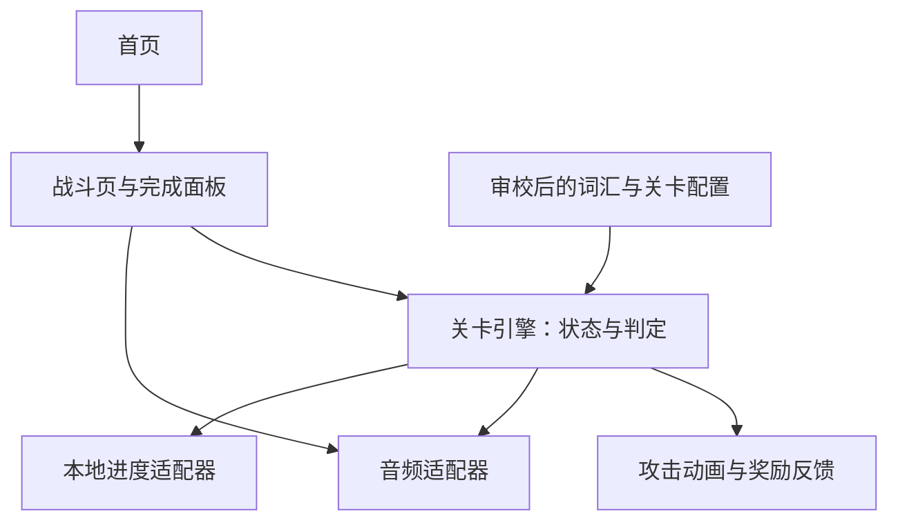

# 单词怪物：微信小程序 MVP 架构

状态：架构草案；用于评审，不代表业务规则全部确认或功能已实现。  
创建日期：2026-10-29  
项目目录：`word-monster-weapp`（工程暂名，产品名待定）

## 1. 产品目标

做一个短时闯关英语小游戏：主角固定在屏幕下方，孩子听到英语后点击正确的单词怪物，武器发射、怪物消失并积攒能量；达到阶段后武器发生升级变化。

第一阶段只验证两件事：孩子是否愿意再次玩，以及是否能在没有文字答案提示时听音辨认对应物品。通关、能量和武器等级都不等于掌握词汇，更不代表已经会拼写或口语表达。

### 已明确的方向

- 微信小程序，功能尽量简单，有趣味性。
- 闯关、下方固定主角、单词怪物、武器、消灭目标积能量、阶段性升级。
- 学习与攻击结合：优先采用听音选择目标的方案。
- 本次交付仅为项目文件夹与架构文档。

### 建议的最小体验包

以下为待确认的内容配置，不作为未经确认即可开发的业务规则：

- 一个水果主题，5 个精选词，具体词表经内容审校后确定。
- 一关包含初遇、辨词战斗和守关挑战三个阶段。
- 一把武器，3 个视觉阶段；每局目标约 2—3 分钟。
- 普通战斗同时展示 2—3 个图片目标；主角不走位。
- 不引入实时 AI、实时语音识别、开放式对话或拼写输入。

## 2. 学习与战斗流程

1. **初遇**：单个目标展示图片、英文和发音，孩子点击体验攻击。这是教学演示，不计独立答对。
2. **辨词战斗**：播放一个单词，孩子从图片目标中选择；作答前不显示目标英文和中文答案。
3. **正确选择**：先提交判定，再播放攻击与命中动画；展示单词并重播读音，按照已确认规则结算能量。
4. **错误选择**：提供温和反馈，保留当前学习机会；重播、何时提示、何时再次安排该词等规则待确认。
5. **守关挑战**：每次辨词对应一次攻击或拆盾，完成后显示结果。护盾数待确认。
6. **结束**：显示完成反馈与本次表现，可重玩；不将提示后答对包装成独立掌握。

升级建议改变弹道、音效和命中演出。若加入伤害数值，必须另外明确怪物血量及升级关系，不能借助范围攻击自动完成尚未回答的学习题。

## 3. 范围与页面

### 第一版建议保留

- 首页：开始入口，简短玩法说明；是否支持局中继续见待确认项。
- 战斗页：上方目标、下方固定主角、重播按钮、能量展示。
- 战斗页内完成面板：本局结果和再次挑战入口，不单独做报告页。
- 固定词汇、图片、预制发音、攻击特效。
- 本地保存最近完成结果和必要的答题记录。

### 第一版排除

- 用户账户、云同步、好友、排行榜、付费和广告。
- 武器商店、多货币、抽奖、复杂装备属性、宠物养成。
- 完整教材、开放题库、中文故事、长篇阅读、思维导图导航。
- 麦克风录音、口语评分、作文批改、每次游玩调用大模型。
- 家长后台、运营后台、大规模埋点系统。

## 4. 技术方案

建议采用原生微信小程序、TypeScript、WXML、WXSS；通过微信开发者工具开发和真机调试。两页即可，无需引入跨端框架、游戏引擎或业务后端。

以普通视图和短动画绘制少量目标、角色和攻击特效；判定基于目标 ID，不需要物理碰撞。画面只呈现判定结果，不决定答案正误。若后续原型出现真实渲染瓶颈，再评估 Canvas。

固定发音预先录制或生成并审听，与图片一起随最小内容包交付。运行时无大模型 Token 消耗；资源制作、分发和后续托管仍可能有成本。微信基础库版本和资源包大小在实现时根据实际资源及官方文档确定，不在此凭空设定。

## 5. 模块边界



| 模块 | 职责 | 不承担的职责 |
| --- | --- | --- |
| 内容配置 | 词条、资源路径、关卡顺序、已确认参数 | 网络生成新题 |
| 关卡引擎 | 当前题、输入是否可接受、答题记录、结算与阶段切换 | 直接操作 UI、播放音频 |
| 战斗视图 | 展示状态，将点击转换成事件 | 自行加能量或判断掌握 |
| 反馈组件 | 命中、升级、完成动画 | 以动画次数结算奖励 |
| 音频适配器 | 发音与音效播放、停止、失败反馈 | 将播放失败计为孩子答错 |
| 进度适配器 | 版本化读写本地记录、损坏数据回退 | 跨设备同步 |

不为只有一关的 MVP 引入通用插件系统、事件总线或复杂领域框架。

## 6. 建议目录结构

以下是未来实现布局，本次仅创建本架构文档。

```text
word-monster-weapp/
├── architecture.md
├── project.config.json          # 实现时创建；真实 AppID 待提供
├── tsconfig.json
└── miniprogram/
    ├── app.ts
    ├── app.json
    ├── app.wxss
    ├── pages/
    │   ├── home/                # 开始入口
    │   └── battle/              # 游戏与完成面板
    ├── components/
    │   ├── monster/             # 图片目标与状态反馈
    │   └── weapon/              # 主角武器与攻击演出
    ├── game/
    │   ├── types.ts
    │   ├── engine.ts            # 纯逻辑状态转换
    │   └── rules.ts             # 已确认的参数与结算规则
    ├── content/
    │   ├── words.ts
    │   └── levels.ts
    ├── services/
    │   ├── audio.ts
    │   └── progress.ts
    └── assets/
        ├── images/
        └── audio/
```

## 7. 最小数据契约

下面的类型描述模块交换的信息；具体阈值和调度规则待确认。

```ts
type Phase = 'intro' | 'practice' | 'boss';

interface Word {
  id: string;
  text: string;
  meaningZh: string;       // 教学与结果解释使用，不泄露战斗答案
  imagePath: string;
  audioPath: string;
}

interface Round {
  id: string;
  phase: Phase;
  targetWordId: string;
  optionWordIds: string[]; // 不重复，必须且仅包含一次正确目标
}

interface Attempt {
  roundId: string;
  targetWordId: string;
  selectedWordId: string;
  correct: boolean;
  hintUsed: boolean;
  replayCount: number;
  attemptIndex: number;
}

interface SessionResult {
  sessionId: string;
  levelId: string;
  contentVersion: number;
  completed: boolean;
  attempts: Attempt[];
  completedAt?: number;
}

interface LocalProgress {
  schemaVersion: number;
  recentResults: SessionResult[]; // 有界保留，具体上限实现前确定
}
```

教学点击、首次独立选择、错后重试、提示后完成应可以区分。不要用所有点击的正确比例直接声称“掌握率”。图片选项应保持视觉清晰且无歧义，目标位置不能固定泄露答案。

## 8. 状态与交互约束

主要状态：`ready → presenting → awaitingAnswer → feedback → nextRound / upgrade / completed`。另有 `paused` 和 `audioError`。

- `presenting`：加载并播放题目音频；成功后允许作答。
- `awaitingAnswer`：接受一次有效选择；事件带当前 roundId，过期事件丢弃。
- `feedback`：锁定重复点击，记录判定并播放反馈；结束后由引擎决定后续状态。
- `upgrade`：表现已结算的升级，不再次发放奖励。
- `completed`：以 sessionId 幂等保存结果，防止重复完成回调写入多次。
- `paused`：切后台时停止音频、取消未完成动画回调；恢复时重现当前已提交状态，不重复奖励。
- `audioError`：显示重试；发音不可用时不跳题、不误判孩子答错。

动画结束事件携带轮次标识；同时应有受控的完成兜底，避免动画回调丢失后卡住。退出页面释放音频与定时器。重播时不叠加播放，音效不能盖过单词发音。

奖励来源必须是引擎接受并结算的事件，禁止靠计时器自动增长能量。提示后答对如何给能量待确认，但无论奖励如何，学习记录都应保留提示事实。

## 9. 本地存储与内容交付

- MVP 本地保存，不承诺换设备或清理缓存后恢复。
- 记录附带 schemaVersion 和 contentVersion；不兼容数据安全回退，避免用旧题序恢复新关卡。
- 写入失败允许完成本局，并明确结果未保存。
- 不默认收集姓名、头像、手机号、录音等信息。
- 最小内容包采用固定资源；上线前核对素材来源和使用权限，不直接沿用旧项目的奥特曼形象作为产品角色。
- 若以后加入服务端或实时生成，应另写架构决策，不作为本次必要依赖。

## 10. 旧项目复用边界

已检查的参考项目位于同级目录；本次不修改或迁移它们。

| 来源 | 可复用内容 | 需要调整 |
| --- | --- | --- |
| `english-kids-site/lib/words.ts` | 精选词汇与释义作为内容草稿 | 核对难度、词义与对应图片，重新审听发音 |
| `english-kids-site/app/category/[id]/page.tsx` | 点击发音、固定角色呈现的思路 | 改为单一任务页，去掉密集词表与双角色自动对话 |
| `english-kids-site/app/components/UltramanEnergy.tsx` | 能量视觉反馈概念 | 原实现按时间自动涨能量，不能直接复用结算逻辑 |
| `english-kids-site/hooks/useRecorder.ts` | 本版本不复用 | 原随机评分不是学习测评 |
| `kids-learning/src/pages/StoryPage.tsx` | 一屏少量内容、音频重播、进度保存思路 | 去掉拼音与中文故事；使用小程序接口重新实现 |

React 页面、浏览器音频与 localStorage 不能原样作为原生小程序页面使用。优先复用内容与交互经验，保持新工程简单。

同级目录还存在 `english-kids-weapp`；本次未评估其实现，不将其列为已验证依赖，也不覆盖该目录。

## 11. 实施顺序与验收计划

1. 确认第 12 节中影响玩法的规则，形成首关内容表。
2. 完成一题的播放、选择、攻击、结果记录。
3. 接通一关的教学、战斗、守关和升级反馈。
4. 完成本地结果保存、音频失败处理、切后台恢复。
5. 在真机和小范围儿童试玩中检查可用性与趣味性，再决定是否增加关卡。

后续实现验收至少覆盖：

- 无文字答案提示时，能听音选图；每轮仅有一个正确目标。
- 点击正确才触发对应攻击；快速重复点击不重复结算。
- 升级可感知，但不能自动答完剩余词题。
- 提示后完成与首次独立答对可区分。
- 音频失败可重试，切后台没有残留声音或重复奖励。
- 完成面板结果与实际记录一致，保存失败有反馈。

产品验证观察首次是否能独立操作、第二天是否主动想玩、未提示情况下能否辨认练过的词。暂不虚设留存或提分承诺。本次为文档交付，未执行实现测试。

## 12. 开发前待确认

| 问题 | 影响范围 |
| --- | --- |
| 首批面向哪个年级、什么英语基础？ | 词表、提示语言、选项数、任务时长 |
| 是否接受一个水果主题、5 词、一关三阶段作为首版？ | 内容制作、关卡长度 |
| 武器升级只改变演出，还是包含伤害数值？ | 战斗规则与怪物血量 |
| 能量阈值、提示后奖励、重试奖励怎么计算？ | 激励和防重复结算 |
| 升级在每局重置还是永久保存？ | 进度模型与重玩体验 |
| 错误后何时提示？是否有失败、限时或生命值？ | 难度、反馈和状态转换 |
| 退出后重开本局还是从中途继续？ | 是否增加局中快照 |
| 使用哪个微信 AppID，最终按小程序还是小游戏路径发布？ | 工程配置、发布接入；当前按用户要求的小程序形态设计 |

以上涉及业务行为的疑问，在用户确认前不自行实现；不依赖这些规则的内容盘点和技术准备可以继续。

## 13. 实现时核对的官方资料

- [微信小程序框架](https://developers.weixin.qq.com/miniprogram/dev/framework/)
- [微信小程序音频接口](https://developers.weixin.qq.com/miniprogram/dev/api/media/audio/wx.createInnerAudioContext.html)
- [微信小程序本地存储](https://developers.weixin.qq.com/miniprogram/dev/framework/ability/storage.html)
- [微信官方 TypeScript API 类型定义](https://github.com/wechat-miniprogram/api-typings)

这些链接用于实现阶段核对接口和平台要求；本文件未据此声称已经完成真机兼容或上线类目审核。
