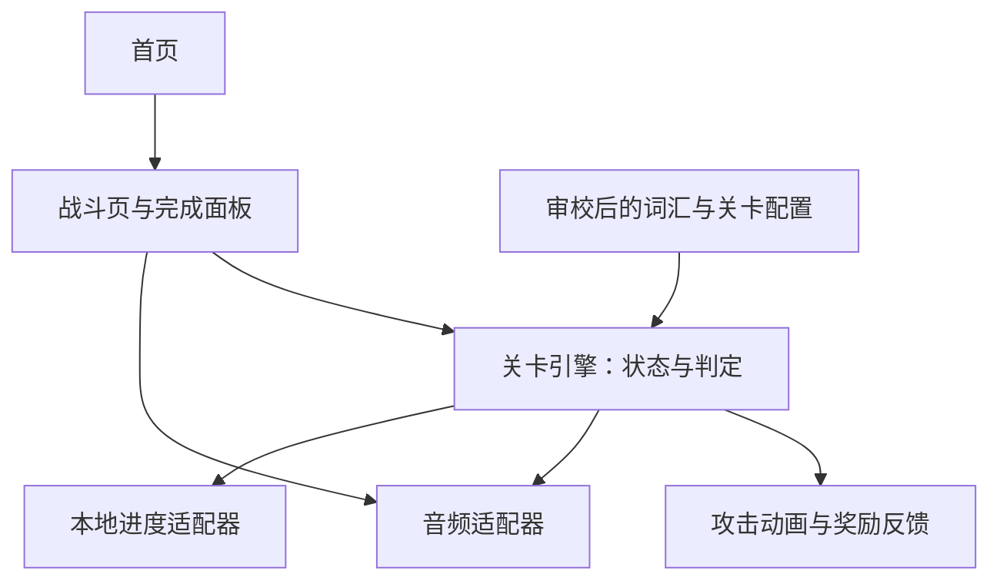

# 单词怪物：微信小程序 MVP 架构

状态：MVP 首关业务规则已于 2026-10-29 经用户全部确认，见第 14 节；平台接入与工单 #3 工程骨架已完成；具体学习与战斗功能尚未实现。
创建日期：2026-10-29  
项目目录：`word-monster-weapp`（工程暂名，产品名待定）

## 1. 产品目标

做一个短时闯关英语小游戏：主角固定在屏幕下方，孩子听到英语后点击正确的单词怪物，武器发射、怪物消失并积攒能量；达到阶段后武器发生升级变化。

第一阶段只验证两件事：孩子是否愿意再次玩，以及是否能在没有文字答案提示时听音辨认对应物品。通关、能量和武器等级都不等于掌握词汇，更不代表已经会拼写或口语表达。

### 已明确的方向

- 微信小程序，功能尽量简单，有趣味性。
- 闯关、下方固定主角、单词怪物、武器、消灭目标积能量、阶段性升级。
- 学习与攻击结合：优先采用听音选择目标的方案。
- 已进入 MVP 工单阶段；首关规则已确认，已完成两页工程骨架及导航，不代表完整玩法已实现。

### 已确认的最小体验包

以下配置已确认，完整题序、奖励和记录口径见第 14 节：

- 一个水果主题，5 个词：apple、banana、orange、grape、watermelon；素材与图音词匹配仍需审校。
- 一关包含初遇、辨词战斗和守关挑战三个阶段。
- 一把武器，3 个视觉阶段；每局目标约 2—3 分钟。
- 辨词同时展示 2 个图片目标，守关展示 3 个；主角不走位。
- 不引入实时 AI、实时语音识别、开放式对话或拼写输入。

## 2. 学习与战斗流程

1. **初遇**：单个目标展示图片、英文和发音，孩子点击体验攻击。这是教学演示，不计独立答对。
2. **辨词战斗**：播放一个单词，孩子从图片目标中选择；作答前不显示目标英文和中文答案。
3. **正确选择**：先提交判定，再播放攻击与命中动画；展示单词并重播读音，按照已确认规则结算能量。
4. **错误选择**：第一次错温和反馈并重播，第二次错后高亮正确目标直到选对；不扣能量、不跳题、不额外插入错词题。
5. **守关挑战**：5 层盾，每题最终选对拆 1 层，5 题完成后通关。错误不拆盾。
6. **结束**：显示完成反馈与本次表现，可重玩；不将提示后答对包装成独立掌握。

升级只改变演出，无血量或伤害数值，不能自动完成尚未回答的学习题。初遇不加能量；辨词和守关每题最终选对加 1 点（含重试、提示后），每题最多一次；3、7 点时升级，每局重置。

## 3. 范围与页面

### 第一版保留

- 首页：开始入口，简短玩法说明；退出战斗页后重新开局，不提供持久化续局入口。
- 战斗页：上方目标、下方固定主角、重播按钮、能量展示。
- 战斗页内完成面板：本局结果和再次挑战入口，不单独做报告页。
- 固定词汇、图片、预制发音、攻击特效。
- 本地保存最近完成结果和必要的答题记录。

### 第一版排除

- 用户账户、云同步、好友、排行榜、付费和广告。
- 武器商店、多货币、抽奖、复杂装备属性、宠物养成。
- 完整教材、开放题库、中文故事、长篇阅读、思维导图导航。
- 麦克风录音、口语评分、作文批改、每次游玩调用大模型。
- 家长后台、运营后台、大规模埋点系统。

## 4. 技术方案

建议采用原生微信小程序、TypeScript、WXML、WXSS；通过微信开发者工具开发和真机调试。两页即可，无需引入跨端框架、游戏引擎或业务后端。

以普通视图和短动画绘制少量目标、角色和攻击特效；判定基于目标 ID，不需要物理碰撞。画面只呈现判定结果，不决定答案正误。若后续原型出现真实渲染瓶颈，再评估 Canvas。

固定发音预先录制或生成并审听，与图片一起随最小内容包交付。运行时无大模型 Token 消耗；资源制作、分发和后续托管仍可能有成本。微信基础库版本和资源包大小在实现时根据实际资源及官方文档确定，不在此凭空设定。

## 5. 模块边界



| 模块 | 职责 | 不承担的职责 |
| --- | --- | --- |
| 内容配置 | 词条、资源路径、关卡顺序、已确认参数 | 网络生成新题 |
| 关卡引擎 | 当前题、输入是否可接受、答题记录、结算与阶段切换 | 直接操作 UI、播放音频 |
| 战斗视图 | 展示状态，将点击转换成事件 | 自行加能量或判断掌握 |
| 反馈组件 | 命中、升级、完成动画 | 以动画次数结算奖励 |
| 音频适配器 | 发音与音效播放、停止、失败反馈 | 将播放失败计为孩子答错 |
| 进度适配器 | 版本化读写本地记录、损坏数据回退 | 跨设备同步 |

不为只有一关的 MVP 引入通用插件系统、事件总线或复杂领域框架。

## 6. 建议目录结构

以下为模块布局；app 与两页导航已实现，其余业务模块目前保留目录，等待后续工单实现。

```text
word-monster-weapp/
├── architecture.md
├── project.config.json          # 已创建；AppID 与基础库见第 15 节
├── tsconfig.json
└── miniprogram/
    ├── app.ts
    ├── app.json
    ├── app.wxss
    ├── pages/
    │   ├── home/                # 开始入口
    │   └── battle/              # 游戏与完成面板
    ├── components/
    │   ├── monster/             # 图片目标与状态反馈
    │   └── weapon/              # 主角武器与攻击演出
    ├── game/
    │   ├── types.ts
    │   ├── engine.ts            # 纯逻辑状态转换
    │   └── rules.ts             # 已确认的参数与结算规则
    ├── content/
    │   ├── words.ts
    │   └── levels.ts
    ├── services/
    │   ├── audio.ts
    │   └── progress.ts
    └── assets/
        ├── images/
        └── audio/
```

## 7. 最小数据契约

下面的类型描述模块交换的信息；阈值、调度和统计口径见已确认的第 14 节。教学记录须可追溯阶段，具体契约在工单 #5 落实。

```ts
type Phase = 'intro' | 'practice' | 'boss';

interface Word {
  id: string;
  text: string;
  meaningZh: string;       // 教学与结果解释使用，不泄露战斗答案
  imagePath: string;
  audioPath: string;
}

interface Round {
  id: string;
  phase: Phase;
  targetWordId: string;
  optionWordIds: string[]; // 不重复，必须且仅包含一次正确目标
}

interface Attempt {
  roundId: string;
  phase: Phase;          // 显式保存阶段，避免教学记录混入独立答对
  targetWordId: string;
  selectedWordId: string;
  correct: boolean;
  hintUsed: boolean;
  replayCount: number;
  attemptIndex: number;
}

interface SessionResult {
  sessionId: string;
  levelId: string;
  contentVersion: number;
  completed: boolean;
  attempts: Attempt[];
  completedAt?: number;
}

interface LocalProgress {
  schemaVersion: number;
  recentResults: SessionResult[]; // 保留最近 20 局已完成结果
}
```

教学点击、首次独立选择、错后重试、提示后完成应可以区分。不要用所有点击的正确比例直接声称“掌握率”。图片选项应保持视觉清晰且无歧义，目标位置不能固定泄露答案。

## 8. 状态与交互约束

主要状态：`ready → presenting → awaitingAnswer → feedback → nextRound / upgrade / completed`。另有 `paused` 和 `audioError`。

- `presenting`：加载并播放题目音频；成功后允许作答。
- `awaitingAnswer`：接受一次有效选择；事件带当前 roundId，过期事件丢弃。
- `feedback`：锁定重复点击，记录判定并播放反馈；结束后由引擎决定后续状态。
- `upgrade`：表现已结算的升级，不再次发放奖励。
- `completed`：以 sessionId 幂等保存结果，防止重复完成回调写入多次。
- `paused`：切后台时停止音频、取消未完成动画回调；恢复时重现当前已提交状态，不重复奖励。
- `audioError`：显示重试；发音不可用时不跳题、不误判孩子答错。

动画结束事件携带轮次标识；同时应有受控的完成兜底，避免动画回调丢失后卡住。退出页面释放音频与定时器。重播时不叠加播放，音效不能盖过单词发音。

奖励来源必须是引擎接受并结算的事件，禁止靠计时器自动增长能量。提示后最终答对同样获得本题的 1 点能量，学习记录必须保留提示事实。

## 9. 本地存储与内容交付

- MVP 本地保存，不承诺换设备或清理缓存后恢复。
- 记录附带 schemaVersion 和 contentVersion；不兼容数据安全回退，避免用旧题序恢复新关卡。
- 写入失败允许完成本局，并明确结果未保存。
- 不默认收集姓名、头像、手机号、录音等信息。
- 最小内容包采用固定资源；上线前核对素材来源和使用权限，不直接沿用旧项目的奥特曼形象作为产品角色。
- 若以后加入服务端或实时生成，应另写架构决策，不作为本次必要依赖。

## 10. 旧项目复用边界

已检查的参考项目位于同级目录；本次不修改或迁移它们。

| 来源 | 可复用内容 | 需要调整 |
| --- | --- | --- |
| `english-kids-site/lib/words.ts` | 精选词汇与释义作为内容草稿 | 核对难度、词义与对应图片，重新审听发音 |
| `english-kids-site/app/category/[id]/page.tsx` | 点击发音、固定角色呈现的思路 | 改为单一任务页，去掉密集词表与双角色自动对话 |
| `english-kids-site/app/components/UltramanEnergy.tsx` | 能量视觉反馈概念 | 原实现按时间自动涨能量，不能直接复用结算逻辑 |
| `english-kids-site/hooks/useRecorder.ts` | 本版本不复用 | 原随机评分不是学习测评 |
| `kids-learning/src/pages/StoryPage.tsx` | 一屏少量内容、音频重播、进度保存思路 | 去掉拼音与中文故事；使用小程序接口重新实现 |

React 页面、浏览器音频与 localStorage 不能原样作为原生小程序页面使用。优先复用内容与交互经验，保持新工程简单。

同级目录还存在 `english-kids-weapp`；本次未评估其实现，不将其列为已验证依赖，也不覆盖该目录。

## 11. 实施顺序与验收计划

1. 首关规则与内容表已确认（第 14 节）；平台接入与工程骨架已完成；继续后续素材审校。
2. 完成一题的播放、选择、攻击、结果记录。
3. 接通一关的教学、战斗、守关和升级反馈。
4. 完成本地结果保存、音频失败处理、切后台恢复。
5. 在真机和小范围儿童试玩中检查可用性与趣味性，再决定是否增加关卡。

后续实现验收至少覆盖：

- 无文字答案提示时，能听音选图；每轮仅有一个正确目标。
- 点击正确才触发对应攻击；快速重复点击不重复结算。
- 升级可感知，但不能自动答完剩余词题。
- 提示后完成与首次独立答对可区分。
- 音频失败可重试，切后台没有残留声音或重复奖励。
- 完成面板结果与实际记录一致，保存失败有反馈。

产品验证观察首次是否能独立操作、第二天是否主动想玩、未提示情况下能否辨认练过的词。暂不虚设留存或提分承诺。工程骨架的本地检查及模拟器导航已验证，完整玩法和真实儿童试玩尚未执行。

## 12. 决策状态与剩余接入事项

首批人群、词表、三阶段题量、题序与选项、错误重试、提示、奖励、升级、重玩、记录保留和表现口径均已确认，完整规则见第 14 节。

| 剩余事项 | 负责工单与影响 |
| --- | --- |
| 真机兼容与体验版验证 | #15；AppID、原生小程序形态和用户开发权限已确认，真机预览尚未执行。 |
| 图片、发音、词义匹配及素材授权审校 | #4；词表已确认，资源质量尚需验收。 |

后续新增或变更业务规则仍需明确确认，不凭空补全。

## 13. 实现时核对的官方资料

- [微信小程序框架](https://developers.weixin.qq.com/miniprogram/dev/framework/)
- [微信小程序音频接口](https://developers.weixin.qq.com/miniprogram/dev/api/media/audio/wx.createInnerAudioContext.html)
- [微信小程序本地存储](https://developers.weixin.qq.com/miniprogram/dev/framework/ability/storage.html)
- [微信官方 TypeScript API 类型定义](https://github.com/wechat-miniprogram/api-typings)

这些链接用于实现阶段核对接口和平台要求；本文件未据此声称已经完成真机兼容或上线类目审核。

## 14. 工单 #1：首关规则（已确认）

状态：2026-10-29 用户回复“全部接受”，以下完整方案、内容表及验收示例正式作为 MVP 实现依据。工单 #1 的规则确认已完成；微信发布形态与 AppID 由工单 #2 单独处理。

### 14.1 已确认的完整方案

| 编号 | 决策 | 已确认规则 |
| --- | --- | --- |
| A | 人群与语言 | 小学 1—2 年级、英语零基础或入门；操作提示用简短中文，单词发音用英语。 |
| B | 内容规模 | 一个水果主题：apple 苹果、banana 香蕉、orange 橙子、grape 葡萄、watermelon 西瓜。词义、图音匹配与素材授权仍需工单 #4 审校。 |
| C | 首关结构 | 初遇 5 题、辨词 5 题、守关 5 题，共 15 题；每个阶段每词出现一次。以约 2—3 分钟为体验目标，不设倒计时、生命值或失败结局，不强制按时间结束。 |
| D | 题序与选项 | 初遇按 B 的词序；辨词与守关各自随机排列 5 词，每阶段不重复。辨词每题 2 个图片选项，守关 3 个；干扰项从其余词中不重复抽取，每题随机打乱位置。一次题内的错误重试不更换题目或选项位置。 |
| E | 错误与提示 | 第一次选错温和反馈并重播，仍可重试；第二次选错后重播并高亮正确目标，此后保留高亮直到选对。错误不扣能量，不自动跳题；当前题完成后继续既定题序，不额外插入错词题。主动重播不限次，单独重播不算答案提示。 |
| F | 攻击与守关 | 初遇点击可体验攻击；辨词选对攻击对应目标。守关显示 5 层盾，每题最终选对拆 1 层，拆完通关；错误不拆盾。无血量和伤害数值，无范围攻击代答。 |
| G | 能量与升级 | 初遇和错误不加能量；辨词/守关每题最终选对均加 1 点，包括错后或提示后选对，每题最多一次。能量达到 3、7 点时升级，武器共 3 个视觉阶段，仅改变演出；完成时共 10 点。能量表示完成进度，不表示学习掌握。 |
| H | 重玩与退出 | 每局能量和武器等级重置；同一活跃会话切后台后可恢复。主动退出战斗页或进程被终止后重新开局，不持久化局中快照。 |
| I | 保存与表现 | 本地保留最近 20 局已完成结果及答题记录。面板显示完成 10 道辨词任务，并将这 10 题分为首次无提示答对、错后无提示完成、提示后完成三类；不显示掌握率。初遇 5 次教学点击单独标记，不计入三类。 |

### 14.2 首关内容表

| 词条 ID | 英文 | 中文 | 初遇题 | 辨词题 | 守关题 |
| --- | --- | --- | --- | --- | --- |
| apple | apple | 苹果 | intro-apple | practice-apple | boss-apple |
| banana | banana | 香蕉 | intro-banana | practice-banana | boss-banana |
| orange | orange | 橙子 | intro-orange | practice-orange | boss-orange |
| grape | grape | 葡萄 | intro-grape | practice-grape | boss-grape |
| watermelon | watermelon | 西瓜 | intro-watermelon | practice-watermelon | boss-watermelon |

各题使用对应词作为正确目标；选项与顺序按 D 生成。题目 ID 在本局内唯一，跨局事件还须以 sessionId 隔离。每题首次播放不计 replayCount，之后主动或错误反馈触发的题目重播计入；正确后的揭示发音不计入该题作答重播。每次选择保留当时的 hintUsed 与从 1 开始的 attemptIndex，提示一旦出现本题持续记为使用提示。教学记录还需阶段标识或可追溯的题目元数据，不能仅靠 correct 字段统计独立答对。

### 14.3 实现与测试验收示例

- 初遇点击 apple：展示攻击，教学记录增加一次，能量仍为 0。
- practice-apple 主动重播一次后第一次选对：归入首次无提示答对，replayCount 为 1，能量增加 1；重复点击与重复动画回调不再增加。
- practice-banana 先选错一次再选对：记录两次选择，归入错后无提示完成，仅最终选对增加 1 点。
- practice-orange 连续选错两次：显示正确目标提示；最终选对仍增加 1 点，归入提示后完成，不归入首次独立答对。
- 能量由 2 到 3、由 6 到 7 时各升级一次；重复升级回调不加能量、不推进其他题。
- 守关一题选错不减盾，最终选对减 1 层；5 题全部完成后盾为 0，总能量为 10。
- 完成面板三类题数之和为 10，教学不混入；保存同一 sessionId 两次仍只有一条结果，第 21 局完成后移除最早的一局。
- 音频失败不新增答题记录、不加能量、不拆盾；后台恢复不重复已提交奖励，进程终止后不恢复未完成局。

### 14.4 确认状态与影响

- A— I 已由用户整套确认，无剩余玩法决策阻塞。
- 主要受影响工单：#4 内容、#5 契约配置、#6 引擎、#8 首页、#9 单题闭环、#10 整关、#11 奖励、#12 存储、#13 生命周期、#14 完成面板；#15、#16 的验收与试玩口径随规则确定。
- 已同步前文口径；相关工单以本节为业务依据。平台接入（#2）、素材审校（#4）和实际验证仍需各自完成，规则确认不等于功能或试玩已完成。

## 15. 工单 #2：平台接入核对（已完成）

核对日期：2026-10-29。沿用用户要求及当前架构的原生微信小程序形态；不切换为小游戏。工程初始化由 #3 执行，已导入开发者工具并验证两页导航；真机预览未执行。

### 15.1 官方依据与工程约定

| 项目 | 核对结论与实施要求 | 来源 |
| --- | --- | --- |
| 工程配置 | 项目根目录使用 project.config.json；compileType 采用 miniprogram，miniprogramRoot 采用 miniprogram/。用户已提供本项目 AppID：wx4b19fe0c462a601b；#3 创建工程时写入 appid，不借用其他项目身份。 | [项目配置文件](https://developers.weixin.qq.com/miniprogram/dev/devtools/projectconfig.html) |
| TypeScript 编译 | 开发者工具支持 setting.useCompilerPlugins 中的 typescript；#3 配置该编译插件，并提供独立类型检查。 | 同上 |
| 基础库 | libVersion 可指定基础库版本。开发者工具实际加载 3.17.5，已在 #3 固定为 libVersion；该版本通过模拟器两页导航验证，#15 仍需完成真机兼容验证。 | 同上 |
| 类型定义 | 采用微信维护的 miniprogram-api-typings，tsconfig 的 types 引入该包；#3 安装时锁定实际版本，避免混装重复类型。类型包版本不等于真机基础库版本。 | [微信官方 API 类型仓库](https://github.com/wechat-miniprogram/api-typings) |
| 资源包 | 官方当前说明：单主包/分包不超过 2M；所有分包合计不超过 30M，服务商代开发不超过 20M。本项目先使用单主包，#4 制作资源时评估体积，#15 用实际打包结果验收；若超限先压缩裁剪，再评估分包，不把总包上限当成主包可用容量。 | [分包加载](https://developers.weixin.qq.com/miniprogram/dev/framework/subpackages.html) |

官方网页已实际读取核对；以上限额不代表本项目已完成包体测量。当前无业务后端，不需要 AppSecret；不得提交 AppSecret、登录凭据或上传私钥。AppID 为项目标识，已由用户提供；用户已确认拥有开发权限；开发者工具登录检查、项目导入和模拟器运行已成功，尚未验证真机预览/上传权限。

### 15.2 工程创建后的导入与真机预览步骤

1. 安装微信官方开发者工具并使用有本项目权限的微信账号登录；记录工具版本、系统和实际安装路径。
2. 在 #3 创建工程后，将仓库根目录导入为小程序项目，填写本项目真实 AppID；确认源码目录为 miniprogram/，TypeScript 编译配置生效。
3. 安装锁定的依赖并执行 #3 提供的类型检查命令；在工具中选择并记录基础库版本，编译到首页，检查控制台错误。
4. 使用工具的预览功能生成二维码，由具备对应权限的微信扫码；验证首页与战斗页的最小导航，记录手机系统、微信版本及预览结果。完整玩法和音频生命周期仍在 #15 验收。
5. 如身份或权限校验失败，由管理员补充开发/体验权限后重试；不将模拟器运行视为真机预览成功，不在本工单执行公开发布。

仓库已建立工单 #3 的 TypeScript 工程骨架及两页导航，已完成导入与模拟器运行；真机预览仍待执行，不以模拟器检查代替。

### 15.3 接入结果与后续验证

- 已收到用户提供的 AppID：wx4b19fe0c462a601b。工单 #3 已将该 AppID 写入 project.config.json；用户已明确确认具有开发权限；可扫码预览的手机情况及实际预览仍未验证。
- 已安装微信开发者工具 2.02.2609240（Intel x64）到 /Applications/wechatwebdevtools.app，并后台启动。腾讯官方下载包 SHA-256 为 1135f929a52297086e83cc3a198293a0416a3e92d09d0264cd848e10e15d1d0c，与 Homebrew 官方仓库记录一致；系统签名验证通过，spctl 返回 accepted / Notarized Developer ID。已通过 check_wechatide_status 验证登录有效，技能版本一致；服务端口与 Codex 授权已启用。
- 基础库已固定 3.17.5；已实际显示首页、点击进入战斗页并返回首页，模拟器错误日志查询无匹配项。
- #2 接入信息确认与操作步骤已完成。先前的端口关闭、授权超时已解决；#3 工程骨架通过模拟器验证。#15 负责后续真机及完整流程验收。

### 15.4 开发权限核对

登录微信公众平台的小程序管理后台，进入“用户身份 → 成员管理”，由管理员核对用于登录开发者工具的微信号是否已绑定为开发成员；未绑定时由管理员添加。仅提供 AppID 或安装工具不等于已验证开发权限。依据：[微信官方开发前准备](https://developers.weixin.qq.com/miniprogram/introduction/)。用户已确认当前微信账号有开发权限；开发者工具扫码登录状态已验证，真机预览仍待执行。不同后台版本菜单位置可能不同，也可在“管理 → 成员管理”查找，以实际界面为准。

## 16. 工单 #3：工程初始化验收

- 已创建原生 TypeScript 工程、home/battle 两页、app 配置，以及 components/game/content/services/assets 的目录边界；未引入后端或游戏引擎。
- 已锁定 TypeScript 5.9.3、微信类型 5.2.3、tsx 4.23.15；npm ci 安装、npm run check 和两项导航测试通过。
- 微信开发者工具 2.02.2609240 / 基础库 3.17.5：项目导入成功，首页截图正常；实际点击后路由进入 pages/battle/battle，再点击返回 pages/home/home；查询 error 日志无匹配项。
- 首次运行时自动化查询曾超时；随后日志与截图确认页面已加载。固定基础库触发重编译后重新验证，两页往返成功。
- 工程包含安装、导入、运行、检查说明；AppID 为公开项目标识，未写入私密凭据。个人工具配置与 artifacts 目录已忽略。
- 此处只验收工程骨架：战斗页为空的场景容器，发音、选图、奖励、存储和真机验证均属后续工单，不宣称已完成可玩 MVP。

## 17. 工单 #5：内容与数据契约验收

- 已实现 Word、Round、Attempt、SessionResult、LocalProgress、GameStatus 与 GameEvent 契约，规则参数来自第 14 节；contentVersion/schemaVersion 均从 1 开始。
- 明确草案补充：Attempt 增加 phase，落实第 14.2 节要求的教学阶段追溯；异步轮次事件增加 sessionId、roundId、revision，供引擎区分跨局、跨题和同题旧回调。这些是已确认行为的技术表达，不增加业务规则。
- words/levels/rules 定义首关 5 词和三个阶段；createRounds 每局一次生成 15 题，初遇固定词序，辨词/守关独立洗牌，干扰项不重复且选项随机排位。Round 与选项数组冻结，重试不重新生成。
- 配置校验拒绝未知/重复词条、错误内容版本、资源清单缺失或错配、阶段/选项数/洗牌策略不符；轮次校验拒绝缺题、重复题、阶段混排、未知选项、缺少或重复正确目标，错误包含字段路径。
- 11 项测试通过（含既有 2 项导航测试）；100 个固定随机种子验证阶段覆盖、唯一正确目标和正确目标位置可变化，另覆盖异常输入与配置不被生成过程修改。类型、工程结构及内容配置检查通过。
- #4 已完成词表和 10 项预期资源登记，尚未制作或审校图片/音频。check:assets 实测因缺失/未审校/权利未核对返回非零，阻止将结构有效的配置误当成正式内容交付。#4 保持进行中；素材清单见 docs/content-assets.md。
- 本次只验收 #5；页面尚未调用关卡生成逻辑，#6 引擎、#9 单题闭环及正式资源交付仍待完成。
