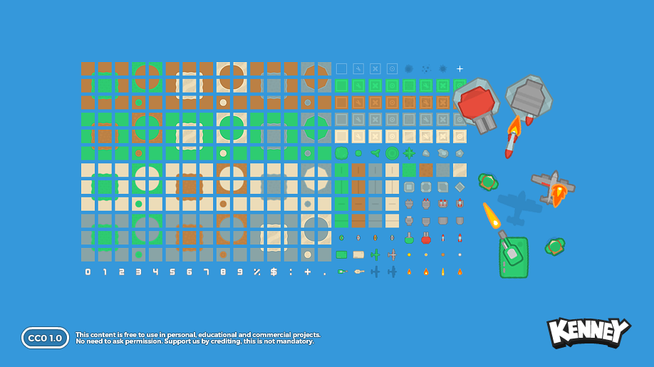

# V2 美术候选记录（#4，2026-10-30）

本目录用于可复核候选，不进入 `miniprogram/` 运行资源或已批准清单。未把旧水果图当成怪物，也未购买或生成替代图片。

## Kenney Tower Defense (Top-Down)

已从 [Kenney 本人在 OpenGameArt 发布的资源](https://opengameart.org/content/tower-defense-top-down) 下载原包；[官网](https://kenney.nl/assets/tower-defense-top-down) 标示相同 CC0 许可。本次官网 ZIP 下载返回 403，改从作者发布的 OpenGameArt 附件取得，ZIP CRC 通过。

原始预览、图集、许可和 SHA-256 记录保留在 [kenney-tower-defense](kenney-tower-defense/manifest.json)。未经裁切、改色或生成；文件尺寸和原包内路径见清单。

视觉检查：圆润的俯视图，有灰色防御构件、绿色角色/炮塔、弹体和受击火焰，可作堡垒构件/武器/子弹候选；并非已完成的底部堡垒、美术统一方案或摧毁状态。角色持武器和基地的具体组合须在 #21 预览中核对。图集含 UI 数字，仅按所选精灵切片取用，不直接展示整张图集。

## Food Monsters Pack：检查后不采用

下载并逐张查看 [Olga “AhNinniah” Bikmullina 的 Food Monsters Pack](https://opengameart.org/content/food-monsters-pack)，包内 LICENSE 为 CC BY 3.0。实际 PNG 包含牛奶盒、瓶子、纸袋、果酱罐、饮料杯、蛋、提包和葡萄罐等 8 图；页面描述为 7 图，应以实际内容逐条核对。

这些形象无法覆盖 apple/banana/orange/grape/watermelon 五个可直接辨识的水果怪，葡萄罐也不冒充葡萄怪。因此不纳入正式资源。下载包只保留临时检查副本，SHA-256：`86ce5f91509d007ae30230cea8af526c28b4602cb3d1e633eeda9f14c70403ec`。

## 仍需完成

五种水果怪、主角与堡垒完整组合、受击/摧毁呈现、最小音效和人工发音听审。#4 继续打开。`npm run check:fortress:assets` 会明确报告缺少五种怪物和五段未听审录音，不能将候选下载计作素材验收完成。
